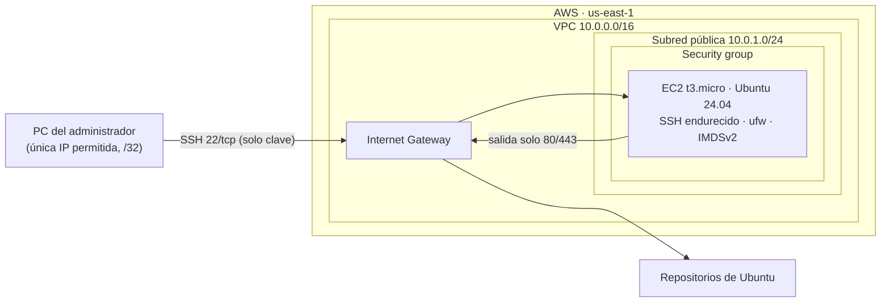

# aws-linux-lab


Servidor Linux **endurecido** en AWS, creado de principio a fin con **Terraform** y configurado automáticamente en su primer arranque.
Un solo comando levanta la red, el firewall y el servidor; otro lo destruye todo.

> Proyecto de portafolio orientado a roles de **SysAdmin Linux / Soporte TI / Cloud junior**.

---

## Arquitectura



| Capa | Qué protege |
|---|---|
| **Security group** (AWS) | Solo deja **llegar** SSH desde la IP del administrador y solo deja **salir** HTTP/HTTPS |
| **ufw** (sistema operativo) | Segunda barrera: bloquea toda entrada salvo SSH, con límite de intentos |
| **sshd** | Solo un usuario, solo con clave, sin root y sin contraseñas |

---

## Qué hace

1. **Terraform** crea una VPC, una subred pública, un Internet Gateway, la tabla de rutas, un security group mínimo, el key pair y una instancia EC2 Ubuntu 24.04 (`t3.micro`).
2. En el primer arranque, el script [`scripts/user-data.sh`](scripts/user-data.sh) **endurece el servidor**:
   - actualiza el sistema;
   - crea un usuario administrador no root (`labadmin`) que solo entra con clave SSH;
   - deshabilita el login de root y la autenticación por contraseña;
   - activa el firewall `ufw` y las actualizaciones de seguridad automáticas.
3. Terraform muestra la IP pública y el comando SSH listo para copiar.
4. Al terminar, `terraform destroy` elimina todo para no generar costos.

## Estructura

```text
aws-linux-lab/
├── terraform/
│   ├── versions.tf                 # Versiones de Terraform y del provider AWS + etiquetas comunes
│   ├── variables.tf                # Entradas del proyecto (con validaciones)
│   ├── main.tf                     # Red, firewall y servidor
│   ├── outputs.tf                  # IP pública y comando SSH
│   └── terraform.tfvars.example    # Plantilla de variables (la real no se sube)
├── scripts/
│   └── user-data.sh                # Endurecimiento en el primer arranque
├── .gitignore                      # Bloquea estado, .tfvars, claves y credenciales
└── .gitattributes                  # Fuerza finales de línea LF en scripts
```

---

## Uso

### Requisitos

- Cuenta de AWS con un usuario IAM (no root) con las políticas `AmazonEC2FullAccess` y `SignInLocalDevelopmentAccess`
- [AWS CLI](https://docs.aws.amazon.com/cli/) 2.32 o superior (para `aws login`)
- [Terraform](https://developer.hashicorp.com/terraform/install) 1.10 o superior
- Un par de claves SSH

### Pasos

```bash
# 1. Iniciar sesión en AWS con credenciales temporales (abre el navegador, con MFA)
aws login

# 2. Crear la clave SSH (se guarda fuera del repositorio)
ssh-keygen -t ed25519 -C "aws-linux-lab" -f ~/.ssh/aws-linux-lab

# 3. Configurar variables: copiar la plantilla y poner tu IP pública con /32
cd terraform
cp terraform.tfvars.example terraform.tfvars
curl -s https://checkip.amazonaws.com     # muestra tu IP pública

# 4. Crear la infraestructura
terraform init
terraform plan        # revisar: "12 to add"
terraform apply

# 5. Esperar 3-4 minutos a que termine el endurecimiento y conectarse
terraform output ssh_command

# 6. Destruir todo al terminar
terraform destroy
```

> ⚠️ **Siempre** ejecutar `terraform destroy` al terminar de usar el laboratorio.

---

## Decisiones de seguridad

### Cuenta de AWS

| Decisión | Por qué |
|---|---|
| MFA en el usuario root y uso mínimo de root | Root tiene control total de la cuenta (incluida la facturación) |
| Usuario IAM con permisos asignados **por grupo** y con MFA | Principio de mínimo privilegio: el usuario no puede tocar IAM ni la facturación |
| `aws login` en vez de *access keys* | Credenciales **temporales**; no hay claves permanentes que se puedan filtrar |
| Presupuesto con alerta por correo | Aviso temprano ante cualquier gasto inesperado |

### Red

| Decisión | Por qué |
|---|---|
| SSH permitido solo desde **una IP `/32`** | Nadie más en internet puede siquiera llegar al puerto 22 |
| La variable de la IP **no tiene valor por defecto** y está **validada** | Imposible dejar SSH abierto a `0.0.0.0/0` o usar una IP privada por error |
| Salida restringida a **80/443** | Lo justo para descargar actualizaciones; limita lo que podría hacer un atacante |
| Security group `default` de la VPC **sin reglas** | Si algo lo usa por error, queda cerrado en vez de abierto |

### Instancia EC2

| Decisión | Por qué |
|---|---|
| AMI de Ubuntu filtrada por el dueño oficial (Canonical) | Evita usar imágenes de terceros con nombres parecidos |
| **IMDSv2 obligatorio** | Protege los metadatos y credenciales de la instancia frente a ataques SSRF |
| Disco **cifrado** (gp3, 8 GB) | Datos protegidos en reposo |
| Créditos de CPU en modo `standard` | Evita cobros extra del modo `unlimited` de las t3 |

### Sistema operativo (`user-data.sh`)

| Decisión | Por qué |
|---|---|
| Usuario `labadmin` sin contraseña (cuenta bloqueada) y con `sudo` validado con `visudo` | Nadie trabaja como root; un error en sudoers podría dejar el servidor sin administración |
| `PermitRootLogin no`, `PasswordAuthentication no`, `AuthenticationMethods publickey` | Solo se entra con clave: la fuerza bruta de contraseñas deja de tener sentido |
| `AllowUsers labadmin` | Ni siquiera el usuario por defecto `ubuntu` (que tiene la clave instalada) puede entrar |
| `MaxAuthTries 3`, `LoginGraceTime 30` | Pocos intentos y poco tiempo para autenticarse |
| Sin X11, *agent* ni *TCP forwarding* | Menos superficie de ataque |
| `LogLevel VERBOSE` | Registra la huella de la clave usada en cada login (útil para auditoría) |
| Configuración en `sshd_config.d/00-hardening.conf` | En sshd gana la **primera** definición; `00-` asegura que se aplique antes que `50-cloud-init.conf` |
| Validación con `sshd -t` antes de reiniciar SSH | Un SSH roto en la nube significa perder el acceso |
| `ufw` con `deny incoming` y `limit 22/tcp` | Defensa en profundidad: segunda capa además del security group |
| `unattended-upgrades` | Parches de seguridad diarios sin intervención manual |

### Repositorio

| Decisión | Por qué |
|---|---|
| `.gitignore` desde el primer commit | El estado de Terraform, las variables reales, las claves y las credenciales nunca se suben |
| `.gitattributes` con `eol=lf` | Un script con finales de línea de Windows falla en Linux |

---

## Pruebas realizadas

Probado sobre una instancia real. La salida está recortada y **sin IPs ni IDs de cuenta**.

### Creación

```text
Apply complete! Resources: 12 added, 0 changed, 0 destroyed.
```

### El script de endurecimiento terminó sin errores

```text
cloud-init[992]: === Inicio del endurecimiento: 2026-11-23T00:35:56+00:00 ===
cloud-init[992]: --- [1/5] Actualizando paquetes
cloud-init[992]: --- [2/5] Creando usuario labadmin
cloud-init[992]: --- [3/5] Endureciendo SSH
cloud-init[992]: --- [4/5] Configurando ufw
cloud-init[992]: --- [5/5] Activando unattended-upgrades
cloud-init[992]: === Endurecimiento terminado: 2026-11-23T00:36:28+00:00 ===
```

```text
labadmin@ip-10-0-1-86:~$ cloud-init status --long
status: done
errors: []
```

### Configuración efectiva de SSH

```text
labadmin@ip-10-0-1-86:~$ sudo sshd -T | grep -Ei 'permitrootlogin|passwordauth|allowusers|maxauthtries'
maxauthtries 3
permitrootlogin no
passwordauthentication no
allowusers labadmin
```

### Firewall del sistema

```text
labadmin@ip-10-0-1-86:~$ sudo ufw status verbose
Status: active
Default: deny (incoming), allow (outgoing), disabled (routed)

To                         Action      From
--                         ------      ----
22/tcp                     LIMIT IN    Anywhere        # SSH con limite de intentos
```

### IMDSv2 obligatorio

Una petición a los metadatos **sin token** es rechazada:

```text
labadmin@ip-10-0-1-86:~$ curl -s -o /dev/null -w "%{http_code}\n" http://169.254.169.254/latest/meta-data/
401
```

### Intentos de acceso no autorizados (desde el PC del administrador)

```text
$ ssh -i ~/.ssh/aws-linux-lab root@<IP-SERVIDOR>
root@<IP-SERVIDOR>: Permission denied (publickey).

$ ssh -i ~/.ssh/aws-linux-lab ubuntu@<IP-SERVIDOR>
ubuntu@<IP-SERVIDOR>: Permission denied (publickey).

$ ssh -o PubkeyAuthentication=no -o PreferredAuthentications=password labadmin@<IP-SERVIDOR>
labadmin@<IP-SERVIDOR>: Permission denied (publickey).
```

| Intento | Resultado |
|---|---|
| `root` con la clave correcta | ❌ Rechazado |
| `ubuntu` (tenía la clave instalada por AWS) | ❌ Rechazado |
| `labadmin` con contraseña | ❌ Rechazado sin ofrecer contraseña |
| `labadmin` con clave | ✅ Único acceso válido |

### Destrucción

```text
Destroy complete! Resources: 12 destroyed.
```

---

## Problemas que encontré y cómo los resolví

| Problema | Causa | Solución |
|---|---|---|
| El usuario IAM no podía registrar su propio MFA | En AWS todo está denegado por defecto y el grupo solo tenía permisos de EC2 | Asignar el MFA desde root, sin dar permisos de IAM al usuario de trabajo |
| `aws login` fallaba por falta de permisos | `aws login` requiere la política `SignInLocalDevelopmentAccess` | Agregarla al grupo del usuario |
| Usé una IP privada (`192.168.x.x`) en `terraform.tfvars` | Tomé la IP del adaptador de VMware en vez de la IP pública | Usar la IP de `checkip.amazonaws.com` y **agregar una validación** que rechaza IPs privadas |
| SSH cerraba la conexión al pedir la passphrase | `LoginGraceTime 30`: tardé más de 30 segundos en escribirla | Tener la passphrase lista antes de conectar (una medida de seguridad funcionando) |

---

## Lo que aprendí

- **Leer infraestructura como código.** Lo que más me costó fue entender `main.tf`: cómo cada bloque crea un recurso y cómo se conectan entre sí con referencias como `aws_vpc.main.id`, que es lo que le permite a Terraform saber en qué orden crear las cosas.
- **Que un servidor completo se puede crear desde la terminal.** Lo que más me llamó la atención fue levantar la red, el firewall y el servidor casi solo desde PowerShell, y poder destruirlo todo con la misma facilidad.
- **El ciclo de Terraform** (`init`, `plan`, `apply`, `destroy`). Sobre todo `plan`: muestra lo que se va a hacer antes de tocar nada, y fue lo que me permitió detectar que había puesto una IP privada.
- **Conectar lo que ya sabía.** Usé temas que vi en el ramo de Sistemas Operativos en INACAP, como las máscaras de red y las direcciones IP (qué significa `/32` o `/16`, y la diferencia entre IP pública y privada), además de la consola de AWS. De [OverTheWire Bandit](https://github.com/eduardovergara-cyber/overthewire-bandit) me sirvió la práctica con Bash y con comandos que ya uso a diario en Linux, como `ssh`, `cat`, `echo`, `grep`, `mkdir`, `chmod` y `rm`, entre otros. Eso me permitió entender el script de endurecimiento, que está construido con esos mismos comandos, y verificar el servidor por mi cuenta.

---

## Próximos pasos

- [ ] GitHub Actions con `terraform fmt`, `terraform validate` y análisis de seguridad con **Checkov**
- [ ] Analizador de logs SSH en Python (**ssh-log-analyzer**) usando los registros de este servidor
- [ ] Acceso con **SSM Session Manager** para no exponer el puerto 22
- [ ] Estado remoto de Terraform en S3 con bloqueo
- [ ] Laboratorio multiusuario: varios usuarios con acceso SSH y distintos permisos dentro del servidor (grupos, `sudo` limitado, carpetas compartidas)

---

## Autor

**Eduardo Vergara** · Estudiante de Ingeniería en Ciberseguridad (INACAP) · [github.com/eduardovergara-cyber](https://github.com/eduardovergara-cyber)
